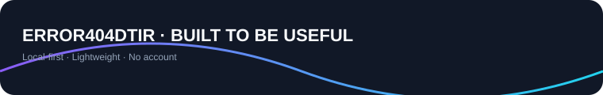

# wsocket-lab

**Browser-native WebSocket client with connection controls, send panel and timestamped event log.**

 

## Quick start

Open `index.html` in a modern browser. No installation, build step, CDN or account required.

## Features

Browser-native WebSocket client with connection controls, send panel and timestamped event log.

- Responsive, self-contained HTML/CSS/JavaScript
- Local browser APIs; no backend or telemetry
- No external dependencies

## Privacy

Data is processed in the browser. WSocket Lab connects only to the endpoint you enter. ExifWipe re-encodes a copy and does not change the source image. EmailCraft exports the HTML you create.

## License

MIT — see [LICENSE](LICENSE).
